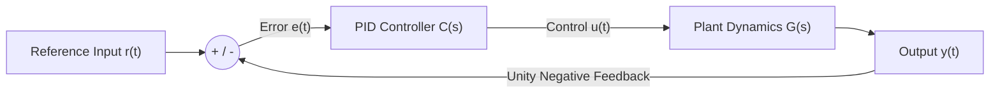

# Precision Control Systems & PID Simulator

[](https://www.python.org/)
[](https://scipy.org/)
[](https://idan-pid-simulator.streamlit.app/)

A professional, high-end web-based engineering dashboard designed to analyze Linear Time-Invariant (LTI) systems and tune **Closed-Loop PID Controllers** in real time across the time domain, frequency domain, and complex $s$-plane.

**[Launch Live Interactive Simulator](https://idan-pid-simulator.streamlit.app/)**

---

## System Architecture & Control Loop

The simulator models a classic unity negative-feedback closed-loop architecture where a configurable PID compensator $C(s)$ regulates an arbitrary continuous-time physical plant $G(s)$:



### Mathematical Formulation
* **Plant Transfer Function:**
  $$G(s) = \frac{N(s)}{D(s)} = \frac{b_m s^m + \dots + b_1 s + b_0}{a_n s^n + \dots + a_1 s + a_0} \quad (m \le n)$$
* **PID Controller:**
  $$C(s) = K_p + \frac{K_i}{s} + K_d s = \frac{K_d s^2 + K_p s + K_i}{s}$$
* **Compensated Open-Loop Transfer Function:**
  $$L(s) = C(s)G(s)$$
* **Closed-Loop Transfer Function:**
  $$T(s) = \frac{Y(s)}{R(s)} = \frac{L(s)}{1 + L(s)}$$

---

## Key Engineering Features

* **High-End Glassmorphism & Avionics Dark Aesthetic:** Sleek dark dashboard (`#0A0E17` obsidian base) engineered with modern typography (`Inter` for UI clarity and `JetBrains Mono` for numeric precision).
* **Glassmorphic Closed-Loop Performance Metrics:** Responsive KPI cards with dynamic status badges:
  * **BIBO Stability:** Dynamic indicator with pulsing live radar (Stable / Unstable).
  * **Rise Time ($t_r$, 10%–90%):** Monospace precision readout of transient response speed.
  * **Settling Time ($t_s$, $\pm 2\%$):** Tolerance envelope settling duration.
  * **Peak Overshoot ($M_p\%$):** Adaptive threshold color tags (Optimal $\le 5\%$, Moderate $\le 20\%$, High $> 20\%$).
  * **Steady-State Error ($e_{ss}$):** Asymptotic tracking fidelity $|r(t) - y(\infty)|$.
* **Interactive $s$-Plane Pole-Zero Radar:** Complex plane with shaded Left-Half Plane (LHP, stable) vs. Right-Half Plane (RHP, unstable) regions, critical stability threshold ($\sigma = 0$), and constant damping ratio ($\zeta$) radial lines.
* **Bode Plot & Stability Margins:** Dual-subplot magnitude (dB) and phase (deg) frequency analysis with Gain Margin (GM) and Phase Margin (PM) crosshair annotations.
* **Closed-Loop Pole Telemetry:** Real-time decomposition of closed-loop eigenvalues with natural frequency ($\omega_n$), damping ratio ($\zeta$), and transient mode classification.
* **Bilingual Support (English & עברית):** Instant toggle between English and Hebrew across all parameters, plots, and metrics.
* **MATLAB / CSV Telemetry Export:** One-click dataset export containing high-resolution time, open-loop response, closed-loop response, and tracking error vectors.

---

## Running Locally

```bash
git clone https://github.com/DanoV1m/pid-control-simulator.git
cd pid-control-simulator
pip install -r requirements.txt
streamlit run app.py
```

---

**Author:** Idan Vimenetz — B.Sc. Student in Electrical & Electronics Engineering
