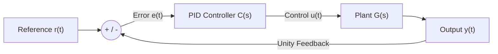

# Interactive Control Systems & PID Controller Simulator

[](https://www.python.org/)
[](https://scipy.org/)
[](YOUR_STREAMLIT_URL_HERE)

An interactive web-based engineering simulation tool designed to analyze Linear Time-Invariant (LTI) systems and tune **Closed-Loop PID Controllers** in real time across the time, frequency, and complex $s$-domains.

**[Launch Live Interactive Simulator](https://idan-pid-simulator.streamlit.app/)**

---

## System Architecture & Control Loop

The simulator models a unity-feedback closed-loop control system where a PID controller $C(s)$ regulates an arbitrary user-defined plant $G(s)$:



### Mathematical Formulation
* **Plant Transfer Function:**
  $$G(s) = \frac{N(s)}{D(s)} = \frac{b_m s^m + \dots + b_1 s + b_0}{a_n s^n + \dots + a_1 s + a_0} \quad (m \le n)$$
* **PID Controller:**
  $$C(s) = K_p + \frac{K_i}{s} + K_d s = \frac{K_d s^2 + K_p s + K_i}{s}$$
* **Closed-Loop Transfer Function:**
  $$T(s) = \frac{Y(s)}{R(s)} = \frac{C(s)G(s)}{1 + C(s)G(s)}$$

---

## Key Engineering Features

* **Dynamic LTI Plant Modeling:** Supports arbitrary proper transfer functions $G(s)$ along with built-in physical presets (DC Motor Speed Control, Series RLC Circuit, Underdamped 2nd-Order, and Open-Loop Unstable plants).
* **Real-Time PID Tuning:** Interactive parameter sliders for Proportional ($K_p$), Integral ($K_i$), and Derivative ($K_d$) gains with automatic pole-zero cancellation handling when $K_i = 0$.
* **Time-Domain Step Response & Metrics:** Automated computation of **BIBO Stability**, **Rise Time ($t_r$, 10%–90%)**, **Settling Time ($t_s$, ±2% criterion)**, **Maximum Overshoot ($M_p\%$)**, and **Steady-State Error ($e_{ss}$)**.
* **$s$-Plane Pole-Zero Map:** Visualizes open-loop and closed-loop poles ($\times$) and zeros ($\circ$) relative to the imaginary stability boundary ($\text{Re}(s) = 0$).
* **Frequency-Domain Bode Plot:** Compares Magnitude (dB) and Phase (deg) responses of the uncompensated plant $G(j\omega)$ vs. the compensated open-loop $L(j\omega) = C(j\omega)G(j\omega)$.
* **MATLAB / CSV Data Export:** One-click export of time-series response and tracking error vectors for external post-processing.

---

## Running Locally

```bash
git clone [https://github.com/DanoV1m/pid-control-simulator.git](https://github.com/DanoV1m/pid-control-simulator.git)
cd pid-control-simulator
pip install -r requirements.txt
streamlit run app.py
```

---
**Author:** Idan Vimenetz — B.Sc. Student in Electrical & Electronics Engineering
